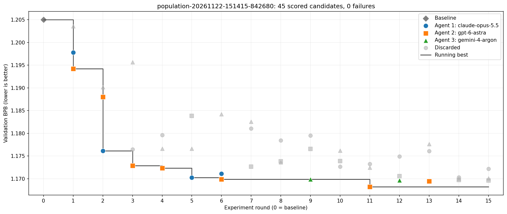

# Autoresearch

A small, educational project for running autonomous LLM training experiments on
one GPU. Copilot SDK agents modify [train.py](train.py), measure the results, and
keep the best scripts. Validation bits per byte (**val_bpb**) is the score:
lower is better.

Use one agent or several models together. Each agent keeps the same conversation
across rounds, learning from its earlier attempts.



## Quick start

**Requirements:** Linux, Git, an NVIDIA GPU with a CUDA 12.8-compatible driver,
[uv](https://docs.astral.sh/uv/getting-started/installation/), and GitHub Copilot
access for autonomous runs. CPU and macOS training are not supported.

Run these commands in a terminal:

```bash
git clone https://github.com/ttschuemp/autoresearch.git
cd autoresearch

# Install Python dependencies
uv sync --locked

# Download data and train the tokenizer (one-time setup)
uv run prepare.py

# Preview the experiment loop without authentication or GPU work
uv run population.py --dry-run
```

uv uses Python 3.11 from [.python-version](.python-version) and creates a local
`.venv` by default. No helper scripts or machine-specific paths are required.
Data and tokenizer files are cached in `~/.cache/autoresearch/`; rerunning
preparation reuses existing files. For a smaller download, use
`uv run prepare.py --num-shards 8`.

Optionally, check training without an AI agent:

```bash
uv run train.py
```

Each trial has a **180-second training budget**, plus startup, compilation, and
evaluation time. The fixed budget is defined in [prepare.py](prepare.py).

## Run the agents

First authenticate using the
[Copilot CLI](https://docs.github.com/en/copilot/get-started/cli-quickstart):
start `copilot`, enter `/login`, then exit after signing in. Alternatively, set
`COPILOT_GITHUB_TOKEN` in your environment or a local `.env` file in the repository
root. The coordinator loads `.env` automatically without overriding existing
environment variables. The file is ignored by Git; never commit tokens.
VS Code sign-in alone is not sufficient.

```bash
# List available models and reasoning levels
uv run population.py --list-models

# Two different agents, keeping the best two scripts
uv run population.py --allow-all-tools \
  --models MODEL_A MODEL_B --keep 2 --rounds 5

# Or start with one agent and two rounds
uv run population.py --allow-all-tools \
  --model MODEL_ID --agents 1 --keep 1 --rounds 2

# All options
uv run population.py --help
```

Replace the model placeholders with IDs from `--list-models`. `--models` takes one
ID per agent. Repeated IDs create separate agents using the same model. The list
length sets the agent count; if you also pass `--agents`, it must match.
Use either `--models` or the shared `--model`, not both.

Defaults are four agents using SDK model defaults, two winners, five rounds, and
sampling seed 42. `--keep` must be between one and the agent count.
`--rounds 0` runs only the baseline, without creating agent sessions.
Optional `--reasoning-effort high` applies to every agent and requires explicit
models that support it. Add `--dry-run` to preview any configuration.

**This is not a sandbox:** autonomous tools and generated training code have your
account's access. Use a dedicated machine and reserve the GPU for one research run
at a time. Live research requires `--allow-all-tools` and may incur Copilot usage.

## How the loop works

The coordinator in [population.py](population.py) is ordinary Python, not another
AI agent:

1. Copy the current [train.py](train.py) and measure a fresh baseline.
2. Each round, sample a parent for each agent uniformly **with replacement** from
   the previous winners. Initially only the baseline is available.
3. Give each agent a new directory with its parent's complete script. Agents edit
   **concurrently**, using one persistent session per agent for the entire run.
   Each receives its previous measured result and the new parent score. Agents
   keep their assigned models and do not receive other agents' reasoning.
4. Train the candidates **one at a time** on the GPU. Weights start fresh;
   candidates share the fixed evaluator, time budget, environment, and cached data.
5. Keep up to `--keep` distinct scripts with the lowest scores from previous winners
   and successful new candidates. Exact source duplicates occupy one slot;
   incumbent winners win score ties.

Edit [program.md](program.md) to change the agents' shared research instructions.
They are loaded once at run start; edits during a run apply to the next run.
Agents only view and edit files. Python handles training, evaluation, and selection.

Discarding a script does not discard its agent: four agents means four sessions
across all rounds. The SDK may compact long conversations near the context limit.
Sessions close at run end or interruption.

Each agent gets one attempt per round, without automatic retries. Failed proposals,
unchanged scripts, invalid metrics, modified fixed helpers, and training failures
cannot become winners. A failed baseline stops the run; failed candidates leave
previous winners eligible. Proposal turns time out after 15 minutes and training
commands after 600 seconds. The sampling seed does not make AI proposals or
wall-clock training reproducible.

## Project structure

| File | Purpose |
| --- | --- |
| [prepare.py](prepare.py) | Data preparation, fixed constants, dataloader, and evaluation |
| [train.py](train.py) | Model, optimizer, and training loop; the only file agents edit |
| [population.py](population.py) | Experiment coordinator, training, and selection |
| [sdk.py](sdk.py) | Copilot authentication and persistent proposal sessions |
| [program.md](program.md) | Shared research instructions you can customize |
| [analysis.ipynb](analysis.ipynb) | Run summaries and the progress chart |
| [pyproject.toml](pyproject.toml) / [uv.lock](uv.lock) | Dependencies and reproducible setup |

## Results

Each run creates a new Git-ignored `results/population-<timestamp>/`:

- `config.json` and `program.md`: settings and instructions used for the run.
- `baseline/` and `rNNN-aNNN/`: archived scripts, fixed helpers, and `train.log`.
  Candidate directories also contain `prompt.txt` and `agent.log`; each agent's
  logged session ID stays the same across rounds.
- `results.jsonl`: one record per completed attempt, including its model, parent,
  score, explanation, and success/failure status. Failed scores are `null`.
- `pool.json`: current winners, atomically updated after each completed round.

The console identifies the best script when finished. The original
[train.py](train.py) and existing results are not overwritten; no Git branches or
commits are created. Ctrl+C stops active proposals and training while preserving
completed results and partial logs. There is no automatic resume.

### Plot the results

Register the project notebook kernel once:

```bash
uv run python -m ipykernel install --user \
  --name autoresearch --display-name "Python (autoresearch)"
```

Open [analysis.ipynb](analysis.ipynb) in VS Code or Jupyter, select
**Python (autoresearch)**, and run all cells from the repository root.
The notebook packages are included in `uv sync`; if an import such as pandas is
missing, check that you selected the project kernel rather than system Python.

The notebook reads the result logs directly and saves [progress.png](progress.png).
It plots the latest run by default; set `RUN` to select another run.
The x-axis shows experiment rounds and the y-axis shows validation BPB.
Results kept after their own round are colored, discarded results are grey, and
results awaiting selection are hollow. Selection uses the same rules as the
coordinator, including script deduplication and score ties.
Compare runs only when their training budgets, evaluation, and hardware match.

## Contributing

Keep changes small, readable, and useful for learning. Use
`uv run population.py --dry-run` to check the coordinator without starting a run.
For training changes, include the hardware, time budget, and measured `val_bpb`
when reporting results.

## License

Based on Andrej Karpathy's [autoresearch](https://github.com/karpathy/autoresearch)
and [nanochat](https://github.com/karpathy/nanochat).
Released under the [MIT license](LICENSE), with upstream attribution preserved.
